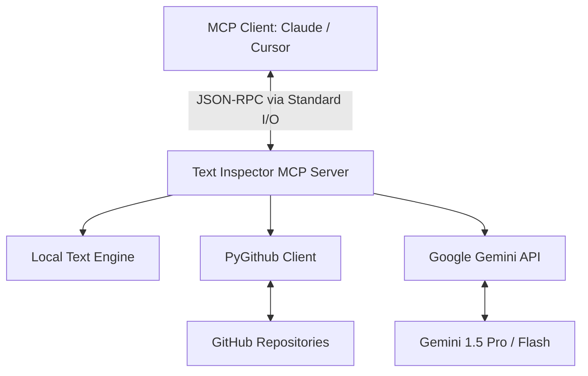

إليك محتوى متكامل، احترافي، وجذاب جداً لملف `README.md` مصمم ليعكس كفاءة المشروع ويجذب المطورين والمستخدمين في مجتمع الذكاء الاصطناعي وMCP:

---

# 🔍 Text Inspector MCP


**Text Inspector MCP** is a lightweight, high-performance Model Context Protocol (MCP) server engineered to elevate how Large Language Models (LLMs) analyze, parse, and process text and codebases. 

By seamlessly bridging native deterministic text extraction (like link extraction and readability metrics) with advanced semantic intelligence powered by **Google Gemini API** and remote context fetching via **PyGithub**, Text Inspector gives your AI assistants (Claude Desktop, Cursor, etc.) supercharged analytical capabilities.

---

## 🌟 Key Features

### 1. 📊 Advanced Text & Code Metrics
* **Granular Statistics:** Calculates word, character, sentence, line, and token counts instantly.
* **Code Complexity Checks:** Identifies code-to-comment ratios, function density, and structural readability.
* **Reading & Execution Time:** Estimates human reading duration and code execution complexity profiles.

### 2. 🔗 Smart URL & Link Intelligence
* **Deep Parsing:** Automatically extracts, normalizes, and validates HTTP/HTTPS links from raw unstructured text or markdown.
* **Domain Profiling:** Groups extracted links by domain and isolates broken or suspicious structural patterns.

### 3. 🧠 Gemini AI-Powered Insights
* **Semantic Code Auditing:** Uses Google Gemini to detect code smells, suggest refactoring strategies, and spot potential bugs.
* **Tone & Sentiment Profiling:** Detects emotional tone, technical density, and target audience alignment for prose.
* **Executive Summarization:** Generates bulletproof summaries tailored for developer or business contexts.

### 4. 🐙 Native GitHub Integration (via PyGithub)
* **Direct File/Repo Inspection:** Inspect raw files, pull requests, or code snippets directly from GitHub URLs without leaving your LLM interface.
* **Contextual Analysis:** Combines remote repo fetching with instant local metric calculation and Gemini analysis.

---

## 🛠️ Architecture Overview



---

## 🚀 Installation & Setup

### Prerequisites
* **Python 3.10+** installed on your system.
* **Google Gemini API Key** ([Get it here](https://aistudio.google.com/)).
* **GitHub Personal Access Token** *(Optional, for higher rate limits on public/private repos)*.

### 1. Clone & Install
```bash
# Clone the repository
git clone https://github.com/your-username/text-inspector-mcp.git
cd text-inspector-mcp

# Create a virtual environment
python -m venv venv
source venv/bin/activate  # On Windows use: venv\Scripts\activate

# Install dependencies
pip install -r requirements.txt
```

### 2. Environment Configuration
Create a `.env` file in the root directory:
```env
GEMINI_API_KEY=your_google_gemini_api_key_here
GITHUB_TOKEN=your_github_personal_access_token_here # Optional
```

---

## 🔌 Integration with MCP Clients

### Claude Desktop Configuration

Add `text-inspector-mcp` to your `claude_desktop_config.json`:

* **MacOS:** `~/Library/Application Support/Claude/claude_desktop_config.json`
* **Windows:** `%APPDATA%\Claude\claude_desktop_config.json`

```json
{
  "mcpServers": {
    "text-inspector": {
      "command": "/path/to/text-inspector-mcp/venv/bin/python",
      "args": [
        "/path/to/text-inspector-mcp/main.py"
      ],
      "env": {
        "GEMINI_API_KEY": "your_google_gemini_api_key_here",
        "GITHUB_TOKEN": "your_github_personal_access_token_here"
      }
    }
  }
}
```

---

## 💡 Practical Example

Once connected to your MCP client (e.g., Claude Desktop), you can ask plain-language questions.

### Prompt:
> *"Can you fetch the Python code from `https://github.com/psf/requests/blob/main/src/requests/api.py`, count its statistics, extract any embedded documentation links, and give me Gemini's refactoring tips for it?"*

### Tool Calls Behind the Scenes:
1. `fetch_github_content`: Retrieves raw file content via PyGithub.
2. `inspect_text_stats`: Calculates 15+ deterministic metrics (lines, methods, character counts).
3. `extract_urls`: Finds all URLs embedded in docstrings.
4. `ai_code_audit`: Passes the code snippet to Google Gemini API for deep static analysis.

### Final Output Received by User:

```markdown
### 📊 File Metrics for `requests/api.py`
- **Total Lines:** 158
- **Code Lines:** 82 | **Comment/Docstring Lines:** 64
- **Estimated Reading Time:** ~2 mins
- **Extracted Links:** 2 external documentation links found.

### 🔗 Extracted Links:
- https://requests.readthedocs.io/en/latest/

### 🧠 Gemini AI Refactoring & Code Quality Audit:
1. **Type Hints:** Excellent coverage across parameters (`url`, `params`, `**kwargs`).
2. **Function Complexity:** Low complexity; functions act as clean wrappers around `Session.request()`.
3. **Recommendation:** Consider adding explicit `@overload` type definitions for better IDE autocompletion when handling context managers.
```

---

## 🧰 Available MCP Tools

| Tool Name | Parameters | Description |
| :--- | :--- | :--- |
| `inspect_text` | `text: str` | Computes word counts, sentence counts, density, and basic readability scores. |
| `extract_urls` | `text: str` | Scans text using regex patterns and returns a structured list of unique valid URLs. |
| `ai_analyze_sentiment` | `text: str` | Leverages Gemini to evaluate tone, clarity, and emotional nuance. |
| `ai_audit_code` | `code: str, language: str` | Uses Gemini to evaluate code quality, edge cases, security, and refactoring potential. |
| `inspect_github_file` | `repo_url: str, file_path: str` | Fetches remote files via PyGithub and runs end-to-end text and structure inspection. |

---

## 🤝 Contributing

Contributions make the open-source community an amazing place to learn, inspire, and create. Any contributions you make are **greatly appreciated**.

1. Fork the Project
2. Create your Feature Branch (`git checkout -b feature/AmazingFeature`)
3. Commit your Changes (`git commit -m 'Add some AmazingFeature'`)
4. Push to the Branch (`git push origin feature/AmazingFeature`)
5. Open a Pull Request

---

## 📜 License

Distributed under the MIT License. See `LICENSE` for more information.